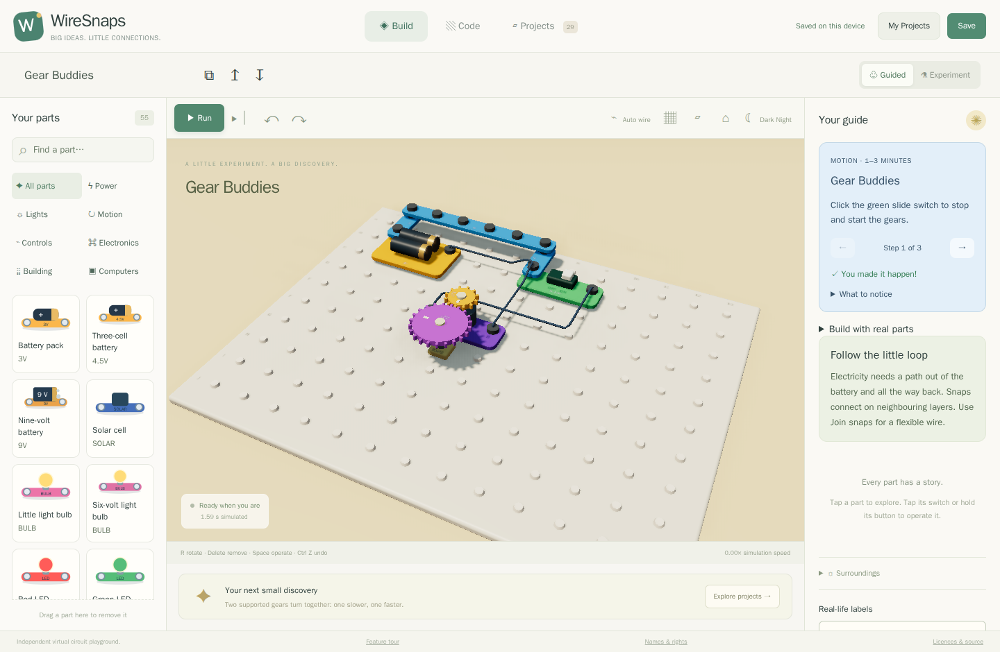
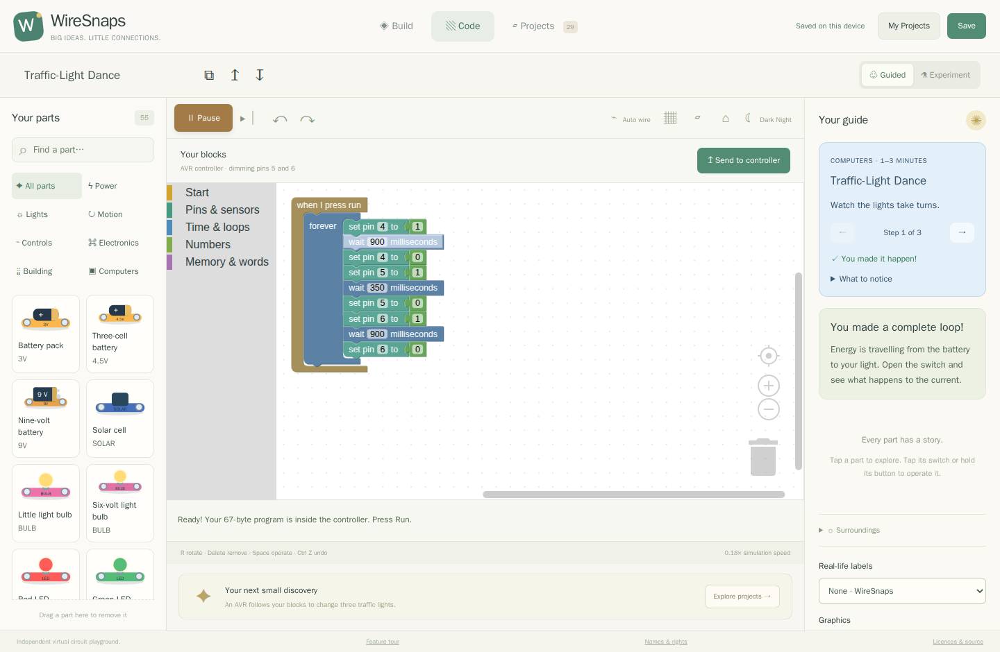
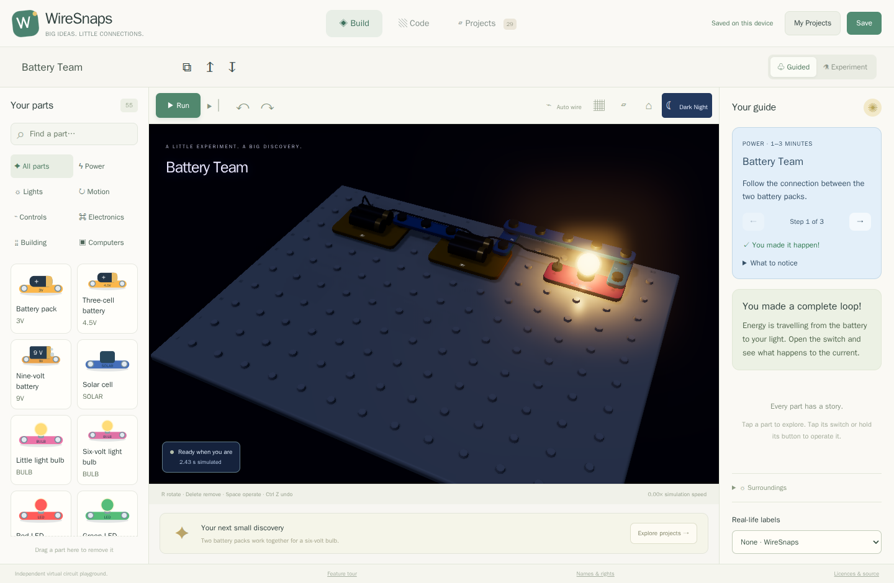
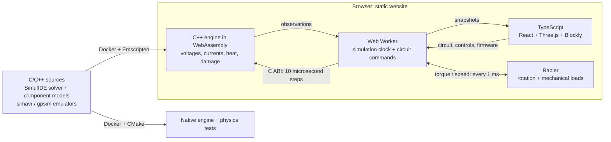

# WireSnaps

Build circuits, write blocks and discover what electricity does in a browser.
A colourful 3D playground backed by a **Qt-free C/C++ engine extracted from
SimulIDE**, with all simulation running locally. No application server required.

| Snap construction | Block programming |
| --- | --- |
| [](docs/images/workbench.png) | [](docs/images/blocks.png) |

<details>
<summary>See Dark Night lighting</summary>



</details>

## Features

**[Take the detailed feature tour](docs/demo/index.md)** — construction, live
rewiring, programming, experiments and [all 29 demos](docs/demo/projects.md).
The built website includes the same guide at `demo/`.

- **Build:** rounded snap parts, collision checks, automatic wiring, animated
  cable rewiring, direct switches/dials, undo and optional kit labels.
- **Explore:** 55 exposed parts, 25 showcases, NPN/PNP collections and four
  simulation-only breakage labs. Guided mode explains problems before damage.
- **Program:** Blockly runs through real AVR/PIC emulators and electrical pins.
- **Keep creating:** local project storage, JSON import/export, light and
  mechanical environments, heating, persistent damage and repair.

**Development milestone:** the full catalogue is unfinished and model parameters
include estimates. See [status](docs/STATUS.md) and [model assumptions](docs/ARCHITECTURE.md).

## Simulation architecture



C++ decides electrical behavior and damage. Rendering follows observations;
its frame rate does not advance physical time. [Architecture details](docs/ARCHITECTURE.md).

## Build & publish

All builds, firmware compilation, tests and previews run **inside Docker**.

```sh
docker build -f docker/Dockerfile --target milestone-export --output type=local,dest=export .
docker compose up preview
```

Open **http://localhost:4173**. `export/site` deploys to a static host, including
GitHub project pages. The whole distribution must stay below **1 GB** and the
compressed runtime below **20 MB**; the build enforces both.

The Pages workflow tests and builds in Docker, updates **`gh-pages`**, and
deploys the same site. Select **GitHub Actions** in the repository's Pages
settings. [Setup and branch commands](docs/PAGES.md).

## Licence

**[GPL-3.0-or-later (GPLv3+)](LICENSE).** Derived from
[SimulIDE `4bf26bc`](https://github.com/SimulIDE/SimulIDE/tree/4bf26bc839147551a00938aa2949012681a3e046).
Original notices are preserved; see [third-party notices](THIRD_PARTY_NOTICES.md)
and [provenance](provenance/upstream.json). The distribution includes corresponding source.

Independent project; manufacturer names are optional references, not endorsement.
See the [preliminary IP review and remaining clearance questions](docs/IP_REVIEW.md).
