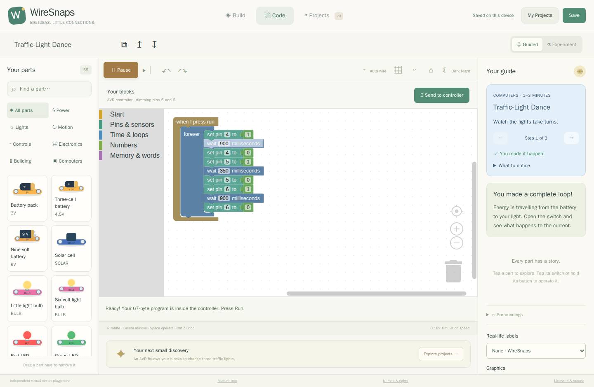

# Give your circuit a little program

WireSnaps connects visual programming to **real emulated processor pins**. Your
blocks cannot directly set a lamp's brightness or a motor's speed. The circuit
still needs a power supply, a return path and appropriate components.

## Traffic-Light Dance: sequence and timing

[Open the AVR traffic-light demo](../../?demo=traffic-code#build)

1. Watch the three lights take turns, then open Code.
2. The supplied loop raises a pin, waits, lowers it and moves to the next light.
3. Change a wait value, press Send to controller, and observe the new rhythm.

**What is happening:** locally compiled bytecode is packaged with the AVR runtime
firmware. The ATmega328P emulator executes it. GPIO pins switch voltage through
the wired resistors and LEDs. Removing a resistor or supply changes the circuit
even when the program itself has not changed.

**Try next:** make one light pause twice as long, or add a short all-off gap
between colours. Pin names on the board and in blocks help you follow the signal.

## Dial-a-Glow: input, decision, output

[Open the PIC dimmer demo](../../?demo=dial-code#build)

Hold the push button and turn the dial. The PIC16F877A program reads a digital
input and an analogue voltage, then controls the LED through a PWM output.
Release the button to stop that output. In Code, inspect the condition and the
sensor reading that feed the brightness command.

**Try next:** swap the branches of the condition so the light responds when the
button is released. The button and dial are electrical inputs, not shortcuts
that reach into the light's visual appearance.

## What the blocks can express

| Blocks | What they let you build |
| --- | --- |
| Start, sequences, repeat and forever | A one-off action or a repeating pattern. |
| Conditions and comparisons | React differently to a button or measured input. |
| Variables and arithmetic | Keep a small count and combine signals. |
| Wait and timing | Make a blink, pause or paced loop. |
| Digital input/output, ADC and PWM | Sense a circuit and send electrical signals back. |
| Serial output | Inspect messages from your running program. |

The workspace is saved as JSON with the project. Compilation happens in the
browser, without a cloud service. Memory limits and invalid programs produce
messages; source-to-block tracing highlights the relevant executing block.

## Understand the boundaries

- The verified initial targets are **ATmega328P and PIC16F877A**. Other imported
  processor families are not advertised as usable programming targets.
- Numbers currently use unsigned bytes: arithmetic wraps modulo 256. It is not a
  general-purpose desktop language.
- Run, Pause and simulation stepping are available. Complete block-by-block
  debugger stepping remains unfinished.
- Output impedance and overload matter. A controller pin is not a motor power
  supply; a suitable transistor driver is needed.
- Advanced users can load HEX firmware from memory for the supported profiles.
  The website does not flash a physical board or access a serial device.

[See the C++ and WebAssembly path](inside.md) · [Explore transistor drivers](projects.md)
