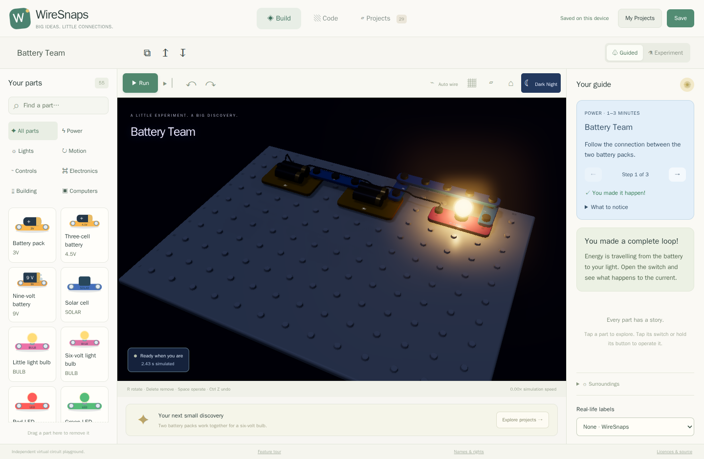

# Find out what changes what

The most useful question is small: **what happens if I change just this?**
WireSnaps connects visible light and motion to electrical observations, so you
can compare your prediction with the circuit's response.

## Light you can see, and darkness a sensor can feel

[Try Battery Team](../../?demo=battery-team#build) · [Try NPN Night Watch](../../?demo=npn-sensor#build)

Turn on Dark Night to see a powered bulb's warm glow and nearby light spill.
Unpowered or failed lights emit nothing. Night also sets the simulated ambient
sunlight to zero, affecting solar cells and light sensors; returning to daylight
restores your sunshine setting.

Light sensing currently uses the **ambient environment**, not a fully spatial
optical simulation of every nearby lamp. The illumination you see is not a
claim that arbitrary optical sensor arrangements are modelled.

## Electricity can become motion, and motion electricity

[Try Gear Buddies](../../?demo=gear-buddies#build) · [Try Wind Makes Watts](../../?demo=wind-watts#build)

The motor model includes torque, inertia, back EMF, current and winding heat.
A motor draws extra current when it cannot turn; a spinning motor can generate
a voltage. Rapier handles the rotor's mechanical response and returns speed to
the electrical model on a fixed schedule.

Gear Buddies has two supported gears. Watch their relative direction and speed,
then open the switch: supplied energy stops and the gears coast down rather than
spinning forever. Wind Makes Watts drives a generator and shows the resulting
voltage on a meter. These are focused educational mechanisms; arbitrary gear
trains, belts, vehicles and every construction accessory are not yet supported.

## One transistor, three useful jobs

| Collection | Sensor | Timer | Motor control |
| --- | --- | --- | --- |
| NPN only | [Night Watch](../../?demo=npn-sensor#build): darkness turns the LED on. | [Porch Timer](../../?demo=npn-timer#build): stored charge keeps a light on after release. | [Desk Fan](../../?demo=npn-fan#build): a dial controls a fan through one NPN. |
| PNP only | [Sunrise Beacon](../../?demo=pnp-sensor#build): daylight turns the LED on. | [Courtesy Light](../../?demo=pnp-timer#build): a brief afterglow with one PNP. | [Breeze Dial](../../?demo=pnp-fan#build): motor control from the positive side. |

Each example uses exactly one transistor of the stated type, with no computer
and no opposite-type transistor. Resistors, capacitors, a sensor or a protective
diode provide the supporting circuit. Compare B, C and E with the terminal guide
to discover why the two transistor types respond to different base polarities.

## Stored energy, one-way paths and separate circuits

- **Firefly Jar:** hold the button, release it and watch stored capacitor energy
  briefly feed an LED. It is an electrical transient, not an animation timer.
- **One-Way Gate:** reverse a diode and compare the current and light output.
- **Relay Light Swap:** a powered coil chooses between contacts in a separate
  circuit. Follow COM, NC and NO to understand the changeover.
- **NPN + PNP Team:** a small signal passes through two transistor stages before
  controlling the load.

## Virtual Breakage Lab

**Simulation only — do not try these experiments with real components.**

These four projects open paused in Experiment mode. Start deliberately, inspect
the current and inside temperature, and watch the intended component fail.

| Experiment | What goes wrong | What you learn |
| --- | --- | --- |
| [Filament Flash](../../?demo=break-bulb#build) | Excess voltage overheats a small bulb. | Ratings matter; a brighter flash can end in an open filament. |
| [The Missing Resistor](../../?demo=break-led#build) | Excess current damages an LED. | Current needs limiting even when a circuit looks simple. |
| [One Load Too Many](../../?demo=break-npn#build) | Several loads overload an NPN. | A small control signal does not mean unlimited load current. |
| [The Stuck Motor](../../?demo=break-motor#build) | A blocked rotor causes winding heating. | Mechanical load changes electrical behavior. |

Failure changes the engine's electrical model. The present failure models open
the failed component's conducting path. Restarting power does not repair it;
select the part and explicitly replace it. Saved projects retain the damage.

Switch the same circuit to Guided mode to see intervention before predicted
failure. Both modes use the same physical models until Guided mode pauses them.
Thermal constants and failure thresholds include estimates: they are educational
models, not a prediction of a particular real component's exact lifetime.

## Change the surroundings

Sunshine, sound level, wind and ambient temperature provide simple environmental
inputs. Select a part to compare voltage, current, temperature and condition.
Sound and optical environments are simplified; full radio, recording and
proprietary sound-module behavior remains unfinished.

Auto, High and Low graphics settings control rendering cost. Shadow, bloom and
depth-of-field effects help read the scene; construction views stay sharp.
Heavy simulation reports its actual speed instead of skipping physical time.
