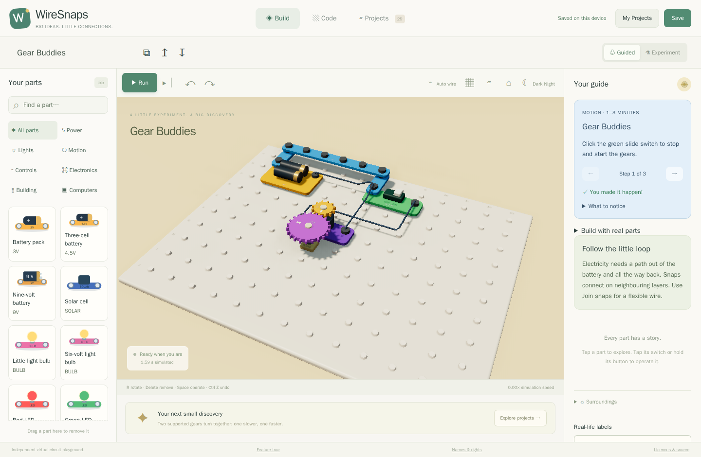
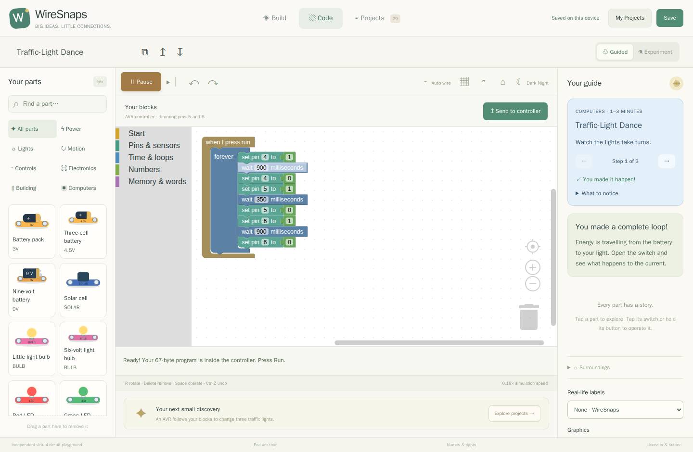
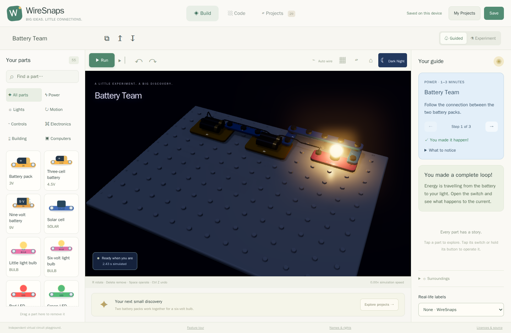

# A little circuit. A big discovery.

WireSnaps is a **3D electronics playground that runs in your browser**. Build a
light, make a fan spin, teach a tiny computer a dance, then change one thing and
see what happens. Electricity, temperature and motion are simulated locally.

**55 parts · 25 showcases · 4 virtual breakage experiments · 2 programmable chip families**

This guide is also published at `demo/` in the built website. Use project links
there to launch a circuit; when reading the repository, find the same title in
the playground's Projects collection.

[Try the glowing bulb](../../?demo=battery-team#build) · [Explore all 29 projects](projects.md)

## Build something you can understand

Rounded parts click onto a board. Polarity signs, diode bands and transistor
pin labels make the connections visible. Solid bodies cannot occupy the same
space; turning a switch changes the circuit immediately. Select a part to learn
what it does, what it needs and what to try next.

**What this lets you do:** discover a complete electrical loop, trace a confusing
connection, build a bridge between layers, and rewire a running circuit without
starting the program again. [Take the construction tour](build.md).

## A tiny computer, with real electrical responsibilities

Stack blocks to wait, repeat, make decisions and read sensors. The program runs
inside an emulated AVR or PIC chip. Its pins supply electrical signals to your
circuit: an LED still needs a resistor, and a motor needs a suitable driver.

**What this lets you do:** make traffic lights take turns, or turn a button and a
dial into a dimmer. Edit the supplied program and watch the circuit respond.
[Explore programming](code.md).

## Night changes more than the picture

A lit bulb throws warm light onto nearby parts. Dark Night lowers the simulated
sunlight too: solar power drops and light sensors change their response. Motor
loads, wind, stored energy and heat give you more ways to investigate cause and
effect.

**What this lets you do:** create a one-transistor night light, store a little
energy in a capacitor or turn a generator to make electricity.
[Explore the experiments](experiments.md).

## Help that stays beside the experiment

- **Guided mode** pauses before predicted damage and suggests a useful change.
- **Next-part ideas** offer up to four candidates after selecting or placing a
  part, with a reason for each suggestion.
- **Short projects** give steps, an expected observation, a completion check and
  something else to try. There are separate NPN, PNP and code collections.
- **My Projects** keeps multiple inventions in this browser, including their
  code, preferences, lesson progress and any virtual damage. Export JSON for a
  portable copy.

## What is ready, and what is still growing

This is a working development milestone. It does **not** implement every part in
every construction kit. Some model constants are educational estimates; detailed
radio, recording and proprietary sound modules are still incomplete. Physical
kit fit and safety are not certified by a simulation.

The default is Guided mode with original WireSnaps names. Some lessons choose a
specific environment, such as night for a night light. Breakage experiments open
paused and carry a persistent simulation-only warning.

[How the simulation works](inside.md) · [Names, licences and reference data](rights.md)

WireSnaps is independent and is not affiliated with or endorsed by the makers of
the construction kits referenced in its optional naming presets.
